<picture>
  <source media="(prefers-color-scheme: dark)" srcset="./assets/hero-motion-dark.svg">
  <source media="(prefers-color-scheme: light)" srcset="./assets/hero-motion-light.svg">
  
</picture>

<h1 align="center">Hi, I'm Jakeuj 👋</h1>

<h3 align="center">Software Architect · .NET, Cloud &amp; AI Developer Tooling</h3>

  Software Architect at GIGABYTE, based in Taipei, with 15+ years of experience
  in software development and architecture across enterprise and gaming platforms.
  I build cloud systems and developer tools, and turn practical troubleshooting
  into reusable technical notes.

  現任技嘉科技架構師，擁有 15 年以上開發與架構經驗，涵蓋企業與遊戲平台。
  專注 .NET、雲端與 AI 開發工具，透過開源作品與繁中技術筆記分享實作經驗。

  
  
  

## Selected Work

  
  
  
  
  
  

<strong>Project details</strong>

- **Jakeuj's Notes** — Reusable Traditional Chinese notes on .NET, cloud, AI tooling, and practical troubleshooting.
  [Read the notes](https://jakeuj.com/default.html) · [Source](https://github.com/jakeuj/writerside) · Writerside / Markdown / GitHub Pages
- **CodexPlugins** — Codex and Claude Code plugins for Evennia MUD development workflows.
  [Source and setup](https://github.com/jakeuj/CodexPlugins) · Codex / Claude Code / Skills
- **Pixer .NET** — Image processing, TCP device transfers, and Pixer picture-frame firmware updates.
  [Source and usage](https://github.com/jakeuj/pixerDotnet) · C# / .NET 9 / TCP
- **PC Quote Sharing／原價屋估價單分享** — Share PC quotes that preserve item prices and quote dates, compare revisions, and review historical prices.
  [Use the tool](https://pc.jakeuj.com/) · [Source](https://github.com/jakeuj/architect-pc-builder) · Python / JavaScript / GitHub Actions
- **Upgrade Value** — Compare live prices of embedded upgrades to guide Guild Wars 2 salvage decisions.
  [Project website](https://gw2-value.jakeuj.com/) · [Install via Nexus](https://raidcore.gg/gw2/addons/upgrade-value) · [Source](https://github.com/jakeuj/GW2-Nexus-Upgrade-Value) · C++ / Nexus / GW2 API
- **PoB Sharer** — Share poe.ninja builds as Chinese PoB pages in one click on Chrome and Edge.
  [Website and installation](https://poe.jakeuj.com/) · [Source](https://github.com/jakeuj/ChromeExtensionPobZh) · JavaScript / Manifest V3

[View all projects／查看完整作品 →](https://jakeuj.com/side-projects.html)

## Recent Work

- **Bandit Save Editor／山寨帳房** — Edit, compare, and export game saves locally, with offline PWA support.
  [Use the editor](https://bandit.jakeuj.com/) · [Source and feature documentation](https://github.com/jakeuj/bandit-save-editor)

## Open-source Contributions

Contributed fixes to [**oMLX**](https://github.com/jundot/omlx), improving memory guidance and model-profile validation for local AI on Apple Silicon. Both changes were merged on 2026-08-18.

- **Prevent an impossible memory-warning loop:** align wired-memory recommendations with the whole-MiB values accepted by the kernel. [PR #2799](https://github.com/jundot/omlx/pull/2799)
- **Make model-profile application more reliable:** resolve VLM-MTP conflicts, preserve valid settings, and return clear validation errors. [PR #2806](https://github.com/jundot/omlx/pull/2806)

## Expertise & Stack

| Focus | Engineering work |
| --- | --- |
| **.NET & ABP** | C#, ASP.NET Core, application architecture, integrations, and modernization |
| **Cloud & DevOps** | Azure, Google Cloud, Docker, CI/CD, observability, and production troubleshooting |
| **AI developer tooling** | Coding-agent skills and plugins, automation, and local AI workflows |

  
  
  
  
  
  
  
  
  
  
  

## Featured Notes

- [**C# 狀態機、狀態模式與策略模式：差異與選擇**](https://jakeuj.com/csharp-state-machine-state-pattern.html) — Compare state machines, State, and Strategy using the same order-processing rules.
- [**DataGrip 連線 Azure SQL：Microsoft Entra Default 驗證 20 秒逾時排錯**](https://jakeuj.com/datagrip-azure-sql-entra-auth-timeout.html) — Trace an authentication timeout across macOS GUI environments, Azure CLI, and database tooling.
- [**Apple Silicon Mac 跑本地 LLM 時，MLX、Ollama、LM Studio、oMLX 怎麼選**](https://jakeuj.com/apple-silicon-mlx-local-llm-tools.html) — Choose a local AI toolchain for chat, model inference, or coding-agent backends.

## Latest Notes

<!-- BLOG-POST-LIST:START -->
- [**GitHub Projects 草稿不顯示：用 gh 查證與原地轉成 Issue**](https://jakeuj.com/github-projects-draft-issue-not-visible.html) — 2026-10-23
- [**AdGuard 不過濾 localhost：User rules 的 $document 例外規則（Mac／Windows）**](https://jakeuj.com/adguard-localhost-allowlist.html) — 2026-10-22
- [**Azure SQL 稽核寫不進儲存體：金鑰重新產生後要重新儲存稽核設定**](https://jakeuj.com/azure-sql-auditing-storage-key-rotation.html) — 2026-10-22
<!-- BLOG-POST-LIST:END -->

[Read all notes](https://jakeuj.com/default.html) · [Subscribe via RSS](https://jakeuj.com/feed.xml)

## GitHub Snapshot

  
  

## Find me around the web

- 💼 **Professional:** [LinkedIn](https://www.linkedin.com/in/jakeuj/) · [Stack Overflow](https://stackoverflow.com/users/4104545/jakeuj) · [ORCID](https://orcid.org/0009-0007-4608-9900)
- 💬 **Community:** [Discord](https://discord.gg/BDaMRGp) · [X](https://twitter.com/jakeuj) · [Facebook](https://www.facebook.com/jakeuj/) · [Instagram](https://www.instagram.com/jakeuj00/) · [Reddit](https://www.reddit.com/user/jakeuj/)
- 🎬 **Video:** [YouTube](https://www.youtube.com/@Jakeuj) · [Bilibili](https://space.bilibili.com/2508649/)
- 📝 **Archive:** [點部落（舊文）](https://www.dotblogs.com.tw/jakeuj)
- ✉️ **Contact & support:** [Email](mailto:jakeuj@hotmail.com) · [PayPal](https://www.paypal.com/ncp/payment/PLYGLLUS2Z8VS)

## Contribution journey

<picture>
  <source media="(prefers-color-scheme: dark)" srcset="./assets/contribution-snake-dark.svg">
  <source media="(prefers-color-scheme: light)" srcset="./assets/contribution-snake-light.svg">
  
</picture>

  

<!-- Dynamic profile content is refreshed daily by GitHub Actions. -->
